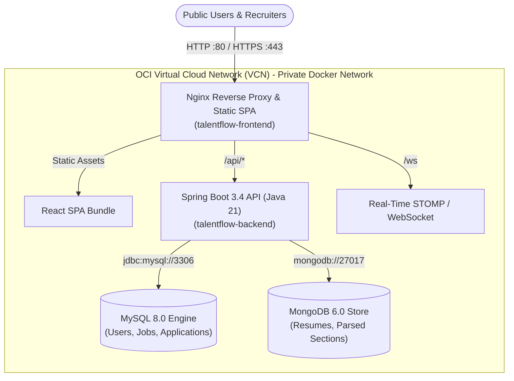

# TalentFlow 360 - Oracle Cloud Infrastructure (OCI) Deployment Guide

This guide walks through deploying the complete **TalentFlow 360** production stack on **Oracle Cloud Infrastructure (OCI)** using Docker and Docker Compose.

---

## 1. Architecture Overview



### Key Security & Performance Attributes:
* **Zero Host Port Exposure for Databases:** MySQL (`3306`) and MongoDB (`27017`) are placed inside an isolated private Docker bridge network (`talentflow-network`). They are **never** exposed to the public internet.
* **Unified Single Origin:** Nginx serves both the React Single Page Application and proxies all `/api/` calls directly to the backend. This completely eliminates CORS preflight overhead in production.
* **Optimized Java 21 LTS Container:** Leverages Eclipse Temurin 21 with G1GC garbage collection tuned for cloud containers (`-XX:MaxRAMPercentage=75.0`).

---

## 2. Step 1: Provision the OCI Compute Instance

Oracle Cloud provides an **Always Free Tier** that is ideal for hosting TalentFlow 360:

1. Log in to the [Oracle Cloud Console](https://cloud.oracle.com/).
2. Navigate to **Compute** > **Instances** > Click **Create Instance**.
3. Configure the instance:
   * **Name:** `talentflow-production`
   * **Image:** `Ubuntu 22.04 LTS` (or `Oracle Linux 8/9`)
   * **Shape:** Click **Change Shape**:
     * Select **Ampere** (Arm-based) > **VM.Standard.A1.Flex**
     * Allocate **4 OCPUs** and **24 GB Memory** (*100% Always Free eligible*).
     * *Alternatively, select AMD VM.Standard.E2.1.Micro if Ampere is unavailable in your availability domain.*
4. Under **Networking**, ensure **Assign a public IPv4 address** is checked.
5. Under **Add SSH Keys**, download your private key (`.key`) to your local machine.
6. Click **Create**. Note down the assigned **Public IP address** once the instance status is `RUNNING`.

---

## 3. Step 2: Configure OCI Ingress Security Rules

By default, OCI blocks incoming HTTP and HTTPS traffic. You must add Ingress Rules in your Virtual Cloud Network (VCN):

1. On your instance page, click on your **Subnet** link under Primary VNIC.
2. Click on the **Default Security List for...**.
3. Under **Ingress Rules**, click **Add Ingress Rules**:
   * **Rule 1 (HTTP):**
     * **Source CIDR:** `0.0.0.0/0`
     * **IP Protocol:** `TCP`
     * **Destination Port Range:** `80`
     * **Description:** `Allow public HTTP traffic`
   * **Rule 2 (HTTPS):**
     * **Source CIDR:** `0.0.0.0/0`
     * **IP Protocol:** `TCP`
     * **Destination Port Range:** `443`
     * **Description:** `Allow public HTTPS traffic`
4. Click **Add Ingress Rules**.

---

## 4. Step 3: Connect to your OCI Server

On your local machine, open PowerShell or Terminal and connect via SSH:

```bash
# For Ubuntu Image
ssh -i /path/to/your-private-key.key ubuntu@<YOUR_OCI_PUBLIC_IP>

# For Oracle Linux Image
ssh -i /path/to/your-private-key.key opc@<YOUR_OCI_PUBLIC_IP>
```

---

## 5. Step 4: Transfer or Clone the Code

Clone your repository or transfer the project folder to the OCI server:

```bash
git clone <YOUR_GIT_REPOSITORY_URL> talentflow
cd talentflow/TalentFlow360
```

---

## 6. Step 5: Execute Automated Zero-Touch Deployment

Run the included automated deployment script with `sudo`:

```bash
sudo chmod +x deploy-oci.sh
sudo ./deploy-oci.sh
```

### What this script automatically handles:
1. Detects OS and installs Docker Engine and Docker Compose plugin.
2. Opens OS firewall ports for `80` and `443`.
3. Creates `.env` and generates secure random passwords for MySQL and JWT secret.
4. Builds backend and frontend containers.
5. Starts MySQL, MongoDB, Spring Boot, and Nginx.
6. Runs health probes until all services report healthy.

---

## 7. Step 6: Verify the Live Application

Once deployment completes, open your browser and access:

* **Web Application:** `http://<YOUR_OCI_PUBLIC_IP>/`
* **REST API Health:** `http://<YOUR_OCI_PUBLIC_IP>/api/v1/health`
* **Interactive Swagger UI:** `http://<YOUR_OCI_PUBLIC_IP>/swagger-ui.html`
* **Spring Boot Actuator:** `http://<YOUR_OCI_PUBLIC_IP>/actuator/health`

---

## 8. Step 7: Configuring Custom Domain & Free SSL (Certbot)

To secure your production deployment with HTTPS (`https://yourdomain.com`):

1. Point your domain DNS **A Record** to your OCI Public IP.
2. Install Certbot on the OCI host:
   ```bash
   sudo apt-get install -y certbot
   sudo certbot certonly --standalone -d yourdomain.com -d www.yourdomain.com
   ```
3. Mount the Let's Encrypt certificates into Nginx by mapping `/etc/letsencrypt` in `docker-compose.yml`.

---

## 9. Useful Operational Commands

| Task | Command |
| :--- | :--- |
| **View Live Container Logs** | `docker compose logs -f` |
| **Inspect Service Status** | `docker compose ps` |
| **Restart Application** | `docker compose restart` |
| **Take MySQL Database Backup** | `docker exec talentflow-mysql mysqldump -u root -p talentflow_db > backup_mysql.sql` |
| **Take MongoDB Document Backup** | `docker exec talentflow-mongo mongodump --db talentflow_resumes --out /data/db/backup` |
| **Update Code & Redeploy** | `git pull && docker compose up -d --build` |
